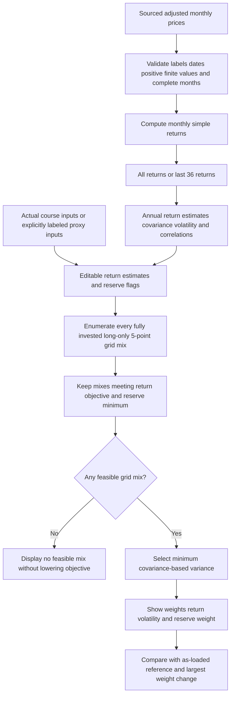

# Lab 15 — Portfolio Stability Decision

Bernat Pascuet Cuesta · FIN 43900 · October 22, 2026

My app, portfolio engine, sourced prices, written analysis and numerical tests are prepared. I confirmed that Meridian and my Project 2 mandate are verified. That confirmation is recorded in STUDENT_CONFIRMATIONS.json; the original Meridian course table is not bundled, so its verification cannot be replayed from these local files. The four-sleeve market-proxy exercise remains clearly separate.

**My decision: reject adoption for now and reconsider after further validation.** I will upload the files to GitHub myself and submit their actual links in Brightspace → Quizzes → Lab 15. No upload or submission is claimed by this package.

## Open and check the app

Open **http://127.0.0.1:8501** on this Mac. See [CHECK_APP.md](CHECK_APP.md) for the exact commands and expected results. The app opens on my bundled three-fund prices. The screenshot exercises and plain-language code explanation are in [CODE_WALKTHROUGH.md](CODE_WALKTHROUGH.md).

If I need to start the local server, from this folder:

```bash
../.venv/bin/python -m streamlit run app.py --server.address 127.0.0.1 --server.port 8501 --browser.gatherUsageStats false
```

On a new computer:

```bash
python3 -m venv .venv
source .venv/bin/activate
python -m pip install -r requirements.txt
python -m streamlit run app.py
```

## Charts

The app includes a grouped allocation chart comparing the current mix with the as-loaded mix, and a risk-versus-return estimate chart with a dashed return-objective line. Both update with return edits, reserve settings, uploads and the 36-month switch. Hover for precise values. Equal current/reference points overlap at the default settings. The Mermaid engine flowchart is included below.

## My mandate and universe

I use VTI, BND and SGOV. My verified mandate uses a 6.5% annual return objective, at least 3% in SGOV, long-only positions and full investment. I confirmed the seven-year policy horizon and 60% VTI / 40% BND diagnostic benchmark represented in project2_mandate.json. This is separate from Meridian's global-equity benchmark and from my KKR Project 1. My confirmation is not a claim of external CIO or instructor endorsement.

| Fund | Portfolio role | Issuer source |
|---|---|---|
| VTI | Broad U.S. equities | [Vanguard](https://advisors.vanguard.com/investments/products/vti/vanguard-total-stock-market-etf) |
| BND | Broad U.S. investment-grade bonds | [Vanguard](https://advisors.vanguard.com/investments/products/bnd/vanguard-total-bond-market-etf) |
| SGOV | Short Treasury exposure / designated reserve sleeve | [iShares](https://www.ishares.com/us/products/314116/ishares-0-3-month-treasury-bond-etf) |

The grid search enforces my numerical return/reserve thresholds, full investment and long-only weights. It does not certify all underlying instrument restrictions, issuer look-through, trading costs, distribution funding, liquidity or future losses. The 3% reserve floor needs at least 5% on a grid with 5-percentage-point steps. A reserve checkbox implements a mandate classification; it does not independently establish regulatory or legal eligibility.

## My data and conventions

prices.csv contains 61 monthly adjusted-price observations from September 2021 through September 2026, producing 60 monthly simple returns. Per-ticker Yahoo history URLs, download times on October 22, 2026 and file SHA-256 are in price_sources.json. The sample excludes incomplete October 2026. Daily provider-adjusted closes are sampled at each month's last trading observation; month-end labels need not themselves be trading dates.

I label the results **historical estimates, not forecasts**. Annual arithmetic mean = monthly mean × 12; sample covariance = monthly sample covariance × 12; volatility is the square root of annual variance. All assets use the same months. I reject missing/nonfinite/nonpositive prices, duplicate/gapped dates and zero-variance assets rather than filling or silently removing them. The last-36 switch selects 36 monthly returns, which require 37 prices. The market-price adjustments reflect the provider's treatment of splits and distributions; today's downloaded history does not prove point-in-time data availability.

To refresh the snapshot intentionally:

```bash
python -m pip install yfinance
python download_prices.py VTI BND SGOV --end-month 2026-09
```

A new download may revise adjusted prices; preserve the current file and source metadata when reproducing these reported results.

## My actual results

| Test | VTI / BND / SGOV weights | Annual return estimate | Annual volatility estimate |
|---|---|---:|---:|
| All 60 monthly returns | 30% / 0% / 70% | 6.54% | 4.85% |
| Last 36 monthly returns | 15% / 0% / 85% | 6.94% | 1.97% |
| VTI mean lower by 1 percentage point | 35% / 0% / 65% | 6.66% | 5.64% |
| Reserve minimum 3% → 8% | 30% / 0% / 70% | 6.54% | 4.85% |
| Additional flat annual cost of 25bp | 35% / 0% / 65% | 6.76% after assumed drag | 5.64% |

The largest window change is **15 percentage points**, and the one-point equity-mean change moves **5 percentage points**. The reserve stress is nonbinding at the base 70% SGOV allocation; the feasible set nevertheless shrinks from 72 to 62 grid mixes. The cost assumption is an incremental flat annual drag, not a turnover-cost estimate or a second subtraction of the fund expense ratio. The corresponding cost-stress gross return is approximately 7.01%. Other rows are gross of incremental implementation costs.

The last-36 sample gives VTI a higher historical mean than the full sample, which permits less equity to reach the unchanged return threshold. When I lower VTI's estimate, the old allocation fails that threshold and requires more equity. BND receives zero weight in these sample-specific solutions; its mean/covariance do not help this particular objective as much as the alternatives. This is not a claim that bonds have no portfolio role.

I do not select the recent window because it looks more attractive or lower the objective to force a mix. The sensitivity is evidence of estimation risk: small changes can alter which allocations are feasible, and the optimizer can make a large allocation change near the return boundary. Results are not a guarantee of future returns or a unique continuous optimum; a 5-point grid can miss off-grid solutions.

## My call, monitoring and reversal condition

I would reject adoption for now. My mandate is verified, but a 15-point window change and a 5-point response to a one-point mean edit leave the starting allocation materially dependent on uncertain estimates. I would reconsider after fresh validation under the same mandate supports an allocation whose sensitivity and net performance I can defend; I would not treat one favorable historical window as sufficient evidence.

I would review reserve coverage, return/covariance estimates, estimated implementation costs and mandate compliance at scheduled reviews. A changed mandate, loss of reserve eligibility or a material validation failure would trigger reconsideration. No approved numerical instability budget has been supplied, so I do not invent one. Deployment would need implementation checks beyond this classroom search.

My two-sentence response to the executed stress is in CODE_WALKTHROUGH.md. It is prepared for discussion and does not assert that a partner performed the test.

## My engine



app.py imports the estimator/search/input loader from portfolio.py and contains no second optimizer. search() enumerates nonnegative integer allocations summing to 20, converts them to decimal weights, filters constraints and minimizes w′Σw. There are 231 three-fund and 1,771 four-sleeve mixes. Exact ties retain the first lexicographic allocation. Full code explanations are in CODE_WALKTHROUGH.md. This AI-enhanced chart is documentation, not evidence of my independent paper drawing.

## Meridian and Lab 14 evidence

I explicitly confirmed **Meridian verified**. The package records this as my confirmation, while retaining the distinction between my verification and what the assistant could execute locally. The original course table remains absent from meridian_inputs.json, so the local Meridian mode explains why a replay is unavailable.

| Original screenshot anchor | Bills / notes / IG / equity | Return | Volatility |
|---|---|---:|---:|
| As loaded | 0 / 20 / 25 / 55 | 6.51% | 9.44% |
| Equity estimate 8% → 7% | 0 / 10 / 10 / 80 | 6.53% | 12.94% |
| IG–equity correlation 0.50 | 0 / 40 / 0 / 60 | 6.52% | 9.73% |

These are instructor reference anchors, not outputs synthesized from an invented table. The expected largest change is 25 percentage points. No original course inputs were inferred by fitting these answers.

**Four-sleeve practice** is a separate app mode using actual historical SGOV/IEF/LQD/VTI market proxies. It provides Lab14 baselines, covariance identities and the grid/sensitivity mechanics, but does not replace the original classroom table. Its full report is in the combined package under Lab14/2026-10-21/four_sleeve/Lab14_Four_Sleeve_Practice.md. Source data and results are also bundled here as four_sleeve_prices.csv, four_sleeve_price_sources.json and lab14_four_sleeve_results.json. Missing Lab14 attendance and independent/no-AI activities are not claimed by the supplement.

## Validation and evidence files

Eight engine/AppTest tests pass, including CSV upload, all/36-month switching, editable returns, infeasibility, proxy mode and shared-engine source mutation. Synthetic test fixtures are labeled and are not investment data or instructor verification. Actual market-data covariance, normalization and source-hash checks also pass. VALIDATION.md records the scope.

```bash
python -m unittest test_engine -v
python run_evidence.py
```

updated_results.json keeps actual executed diagnostics, local missing-source status and my confirmations separately. run_evidence.py preserves infeasibility honestly. An elementary AI-provided covariance example is not represented as my unaided instructor exercise.

## Individual checkout and upload

CHECKOUT.md contains my first-person numerical analysis, claim dispositions, decision and approved growth note. CHECK_APP.md and CODE_WALKTHROUGH.md prepare me to demonstrate and explain the app. I confirmed that the personal drawing, code explanation and partner attack happened. My partner works on Accenture. He also changed an estimate by one percentage point. CHECKOUT.md now contains my completed partner-review response, grounded in my documented test; his unreported exact input/direction/result is not invented or conflated with my VTI output. My token, attendance and contribution entries remain mine, as I requested.

I will handle GitHub. Upload the source files, Markdown, JSON inputs/results and CSV data with their relative paths; exclude virtual environments and caches. GitHub links should point to the actual README.md, app.py, portfolio.py, prices.csv, price_sources.json and updated_results.json, with the supporting files alongside. Use Brightspace → Quizzes → Lab 15 for the actual individual checkout and file links. No external upload, partner activity or receipt is fabricated.

This work was AI-enhanced using OpenAI Codex for research, code, calculations and drafting. My supplied growth note is preserved: “I can now gather and organize data more effectively and use it to make more informed, mature decisions. At this point, nothing feels particularly unclear.”

I am a student, not a financial professional. This document was prepared for FIN 43900 (AI Finance Applications, Purdue) as a class learning exercise. It is not professional investment research or financial advice. I used OpenAI Codex to help with research, analysis, calculations, and drafting. Any remaining errors are my own.
